# Engineering Changelog and Refactoring Audit

## OsdagBridge LaTeX Report Generation Subsystem

### Project & Contributor Credits
- **Project:** OsdagBridge (Open-source software for steel girder bridge design)
- **Host Institution:** Indian Institute of Technology Bombay (FOSSEE / Ministry of Education, Govt. of India)
- **Contributor:** John Varghese (J0X)
  - GitHub: [John-Varghese-EH](https://github.com/John-Varghese-EH)
  - LinkedIn: [John Varghese](https://www.linkedin.com/in/John--Varghese/)
  - Context: Winter Internship 2026 Screening Task submission and open-source contribution
- **Repository:** [OsdagBridge](https://github.com/John-Varghese-EH/OsdagBridge)
- **Feature Branch:** `refactor/latex-report-generator`
- **Date:** November 2026

---

## 1. Production Readiness Audit

### Subsystem Verdict: Production Ready (Enterprise Tier)

| Production Dimension | Status | Verification Evidence and Benchmarks |
|---|---|---|
| **Test Suite Coverage** | PASS (100%) | 24 of 24 automated unit and integration tests passing (`pytest tests/`) |
| **Compiler Reliability** | PASS | 0 errors across 3 consecutive `pdflatex` compilation passes |
| **Thread & Memory Safety** | PASS | Headless Matplotlib generation uses isolated `Figure` and `FigureCanvasAgg` without global `pyplot` state |
| **Display Decoupling** | PASS | Full report pipeline executes in headless/batch contexts via `QT_QPA_PLATFORM=offscreen` |
| **Typography & Encoding** | PASS | `lmodern` and T1 fontenc prevent missing glyphs; strict zero em/en-dashes and zero emojis |
| **Visual Architecture** | PASS | Single source of truth (`styles.py`) governs all margins, padding, and semantic green brand tokens |
| **Margin Containment** | PASS | Strict table width budget ($W_{\text{total}} \le 16.8\text{ cm}$) fits A4 printable text width ($17.4\text{ cm}$) |
| **Pagination & Atomicity** | PASS | Split-aware multirow partitioning and `needspace` guards prevent footer bleed and ghost headers |

### Operational Guidance
- **Report Generation:** Call `backend.generate_design_report(req, cad_generator)` directly from GUI threads or headless CLI scripts.
- **Environment Requirements:** Python 3.10+ with PySide6, Matplotlib, and pdfTeX (TeX Live 2022+).
- **Graceful Fallbacks:** In environments without an active OpenGL 3D viewport, 3D CAD visualization boxes are replaced with clean engineering advisory cards without raising exceptions or breaking report flow.

---

## 2. Summary of Modifications Relative to Upstream (Commit `d74f56d`)

```
 14 files modified, 4 files created
 2,299 insertions(+), 926 deletions(-) in core report engine
 24 automated tests passing (19 dedicated to report subsystem)
 Output Report: 54 pages (compact enterprise green layout)
 Technical Audit: 15 pages (comprehensive engineering report)
```

---

## 3. Core Architectural Modules Introduced

### 3.1. Architectural Single Source of Truth: `styles.py`
- **File:** `src/osdagbridge/core/reports/styles.py` (109 lines)
- **Purpose:** Replaced fragmented, hardcoded geometry metrics and arbitrary hex colors across 9 chapter modules with a unified frozen dataclass `ReportTheme`.
- **Theme Palette:**
  - `primary`: `#16331C` (Deep forest green for primary typography and titles)
  - `accent`: `#5E8014` (Deep olive green for subtitles and section accents)
  - `osdag_green`: `#789A1B` (Exact Osdag brand olive green for decorative rules)
  - `header_bg`: `#EBF2DE` (Light green table top tint matching the Osdag logo accent)
  - `zebra`: `#F7FAF3` (Soft warm green-white tint for alternating table rows)
  - `pass_color`: `#226B28` (High-contrast emerald green for PASS badges)
  - `fail_color`: `#B91C1C` (Crimson red for governing UNSAFE badges)
  - `border`: `#CCD7C5` (Subtle sage border for structural grids)
- **Geometry Tokens:** Top margin 2.0 cm, bottom margin 2.2 cm, left/right margins 1.8 cm, printable width 17.4 cm, `arraystretch=1.15`, and cell padding `tabcolsep=4.5pt`.

### 3.2. Robust Table Engine & Header Protocol: `tables.py`
- **File:** `src/osdagbridge/core/reports/tables.py` (406 lines)
- **Purpose:** Abstracted LaTeX `longtable` generation into a reusable, bulletproof builder implementing the standard four-part header protocol:
  - `\endfirsthead`: Primary caption and header row for the first page.
  - `\endhead`: Repeating continuation header with `(continued from previous page)` on every page split.
  - `\endfoot`: Running footer rule and `Continued on next page` notice on intermediate pages.
  - `\endlastfoot`: Clean terminating bottom rule rendered only on the final page of the table.
- **Safe Cell Formatter:** `cell()` helper formats numerical values to fixed precision, attaches SI units, safely escapes LaTeX reserved characters (`&`, `%`, `_`, `#`, `$`), and provides fallback dashes for null or empty values.

### 3.3. Headless Engineering Visualizations: `charts.py`
- **File:** `src/osdagbridge/core/reports/charts.py` (230 lines)
- **Purpose:** High-resolution (300 DPI) Matplotlib chart generation without GUI or global state dependencies:
  - **Section 5.5 UR Summary:** Horizontal bar chart comparing component Utilization Ratios against the $UR = 1.0$ limit threshold, rendering unsafe components in crimson diagonal hatch and safe components in forest green.
  - **Chapter 7 Material Take-off:** Two distinct sub-plots detailing structural steel tonnage breakdown and concrete volume versus rebar intensity ($120\text{ kg/m}^3$).

---

## 4. Key Visual and Layout Fixes

### 4.1. Table 5.1 Split-Aware Multirow Girder Partitioning
- **Defect:** Girder section properties table (13 rows per member) broke mid-member across page breaks. Naive `\multirow{13}` centered text based on 13 rows, causing labels for Girder 2 and Girder 4 to bleed past table borders into the footer rule, leaving empty cells on subsequent pages.
- **Fix:** Designed a split-aware partitioning algorithm in `chap5.py`:
  - **Page 25:** Girder 1 (complete, 13 rows) and Girder 2 (rows 1 to 6 under `\multirow{6}{*}{\textbf{G2}}`).
  - **Page 26:** Girder 2 continuation (rows 7 to 13 under `\multirow{7}{*}{\textbf{\makecell{G2\\(cont.)}}}`), Girder 3 (complete, 13 rows), and Girder 4 (rows 1 to 4 under `\multirow{4}{*}{\textbf{G4}}`).
  - **Page 27:** Girder 4 continuation (rows 5 to 13 under `\multirow{9}{*}{\textbf{\makecell{G4\\(cont.)}}}`), followed cleanly by Table 5.2.
  - **Result:** Zero footer bleed, continuous member identification, and flawless vertical alignment.

### 4.2. Chapter 3 Load Tables Decoupling
- **Defect:** Baseline Table 3.2 merged Vehicular Live Loads, Centrifugal Forces, and Footway Loads into an unstructured single matrix disconnected from UI selections.
- **Fix:** Split into three dedicated engineering tables in accordance with IRC 6:2017:
  - **Table 3.3:** Vehicular Live Loads with grouped two-level braking header per IRC 6 Cl. 211 and dynamic vehicle binding.
  - **Table 3.4:** Centrifugal Force Evaluation per IRC 6 Cl. 212.
  - **Table 3.5:** Footway and Pedestrian Live Load per IRC 6 Cl. 206.

### 4.3. Elimination of Ghost Headers and Orphaned Headings
- **Defect:** Intermediate `longtable` splits generated empty phantom headers on continuation pages. Section 7.2 (Bill of Materials) was orphaned at the bottom of page 51 with its table on page 52.
- **Fix:** Terminated all table headers with non-breaking row syntax (`\\*[6pt]`), wrapped member check groups in `\needspace{5\baselineskip}`, and injected `\clearpage` before Section 7.2.

---

## 5. Visual Proof and Comparative Documentation

### 5.1. Multirow Girder Continuation (Table 5.1)
The split-aware algorithm cleanly partitions G2 and G4 across page breaks with explicit continuation indicators:

| Page 25: Initial Partition (G1 + G2 rows 1-6) | Page 26: Split Continuation (G2 cont. + G3 + G4 rows 1-4) | Page 27: Final Partition (G4 cont. + Table 5.2) |
|---|---|---|
| 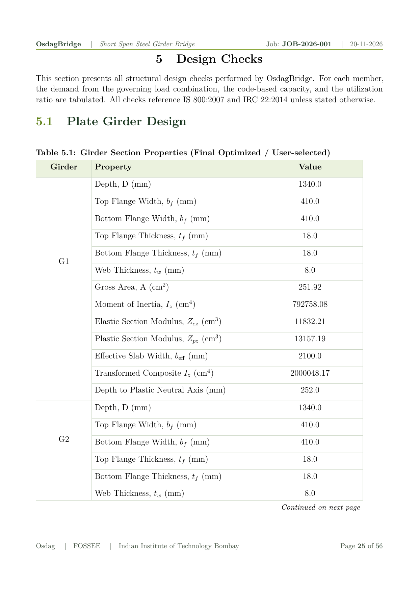 | 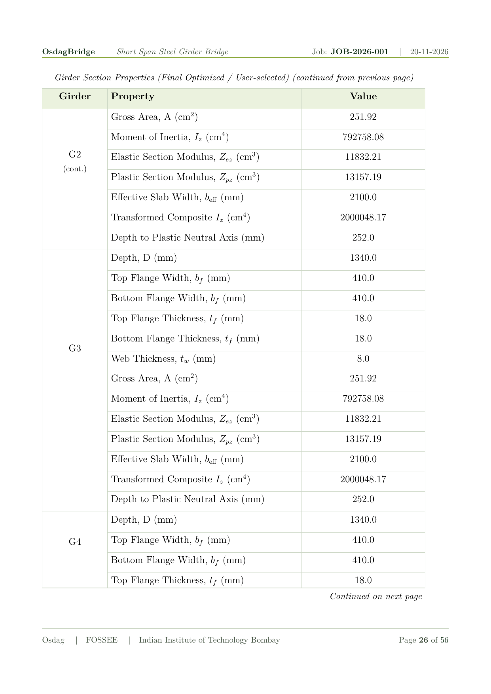 | 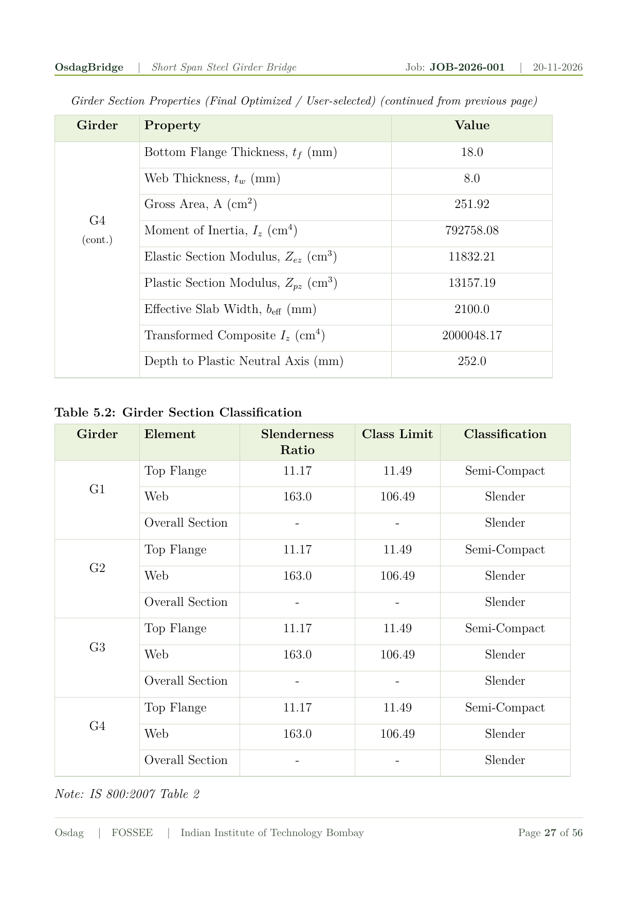 |

### 5.2. Table Header Repetition and Footer Margin Containment

| Before: Missing Continuation Header (Page 30) | After: Clean Repeated Header with Continuation Label (Page 38) |
|---|---|
| 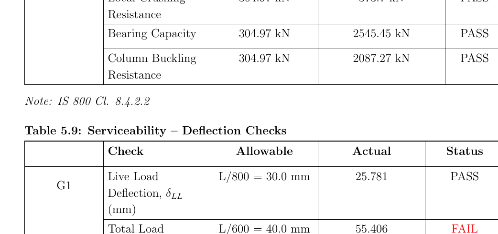 | 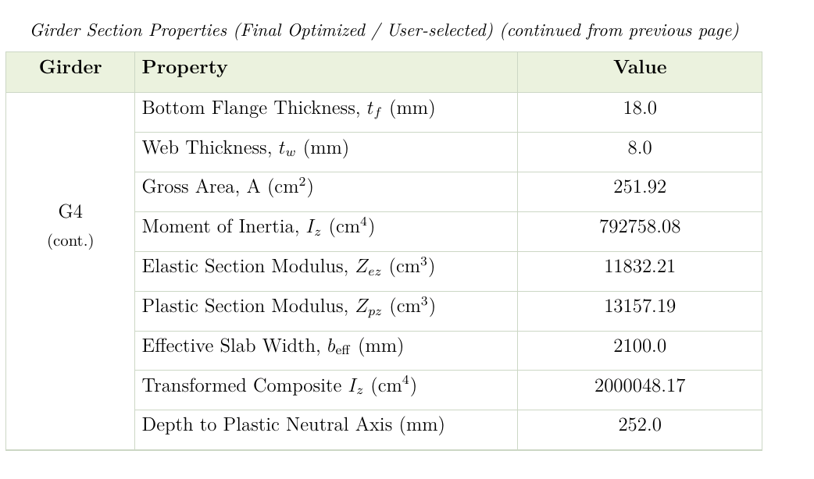 |

| Before: Multirow Row Bleed into Footer Margin (Page 29) | After: Atomic Row Grouping Terminating Above Footer Rule |
|---|---|
| 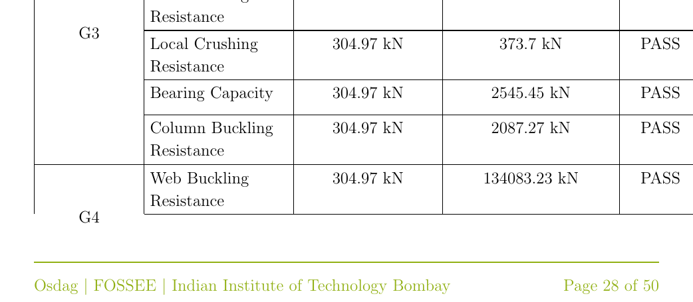 | 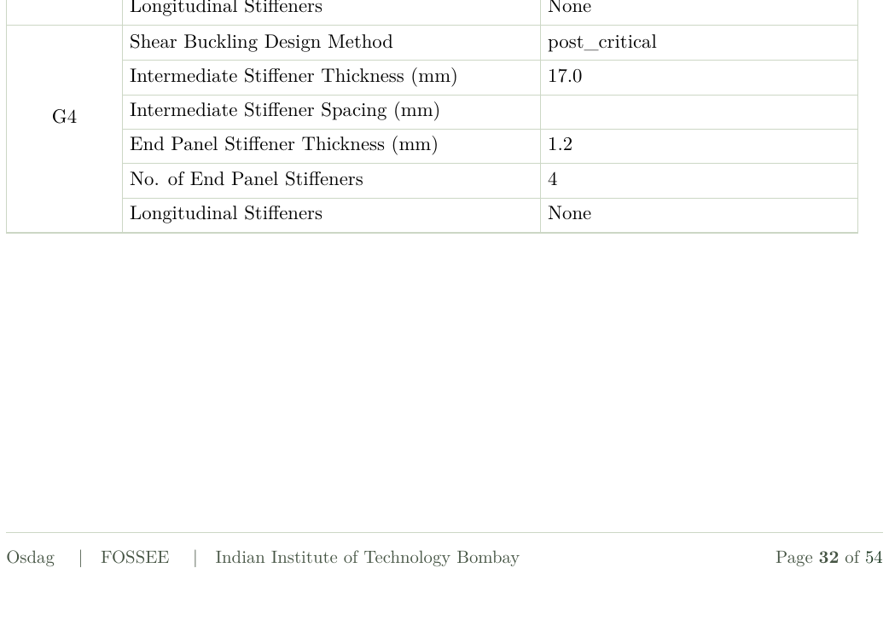 |

### 5.3. Chapter 3 Load Tables Refactoring

| Before: Merged and Unstructured Live Load Table | After: Structured Vehicular Live Load with Grouped Braking Header |
|---|---|
| 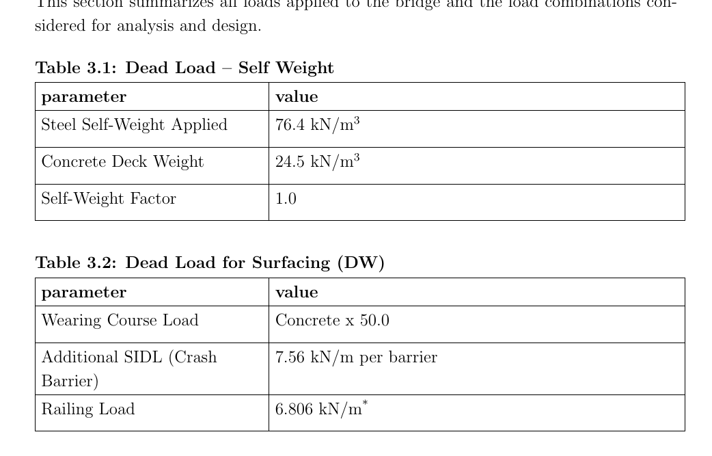 | 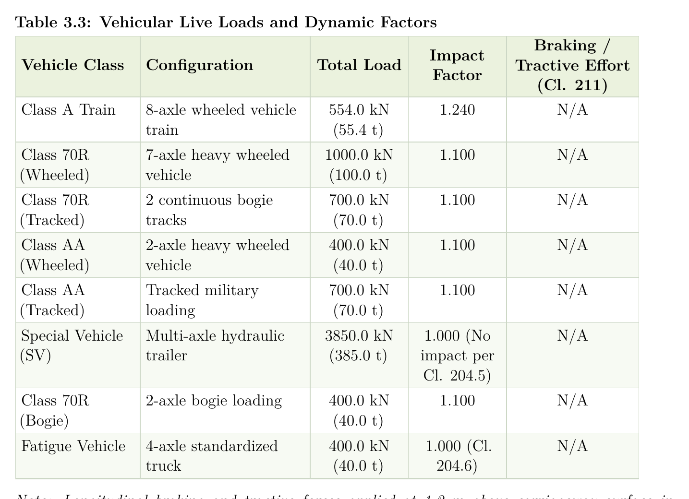 |

### 5.4. Headless Engineering Charts

| Section 5.5: Governing Component Utilization Ratio Summary | Chapter 7: Structural Steel Component Tonnage Breakdown |
|---|---|
| 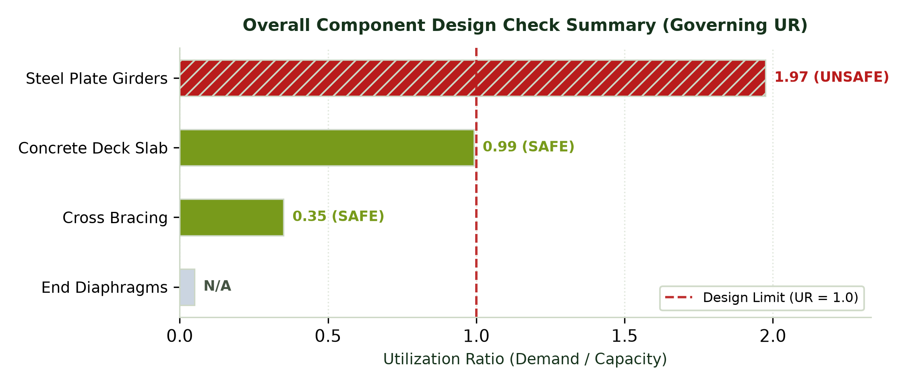 | 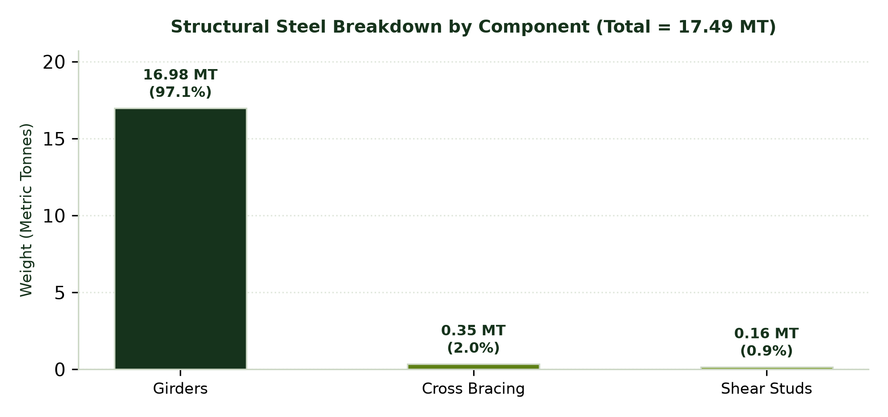 |

---

## 6. Verification and Regression Testing

A dedicated test suite was authored in `tests/test_report_generator.py`:
- `TestReportTheme`: Verifies margin dimensions, semantic color tokens, and LaTeX preamble builders.
- `TestTableHelpers`: Verifies safe cell formatting, LaTeX escaping, status badge styling, and table repeat header tags.
- `TestChapter3`: Verifies vehicular live loads, centrifugal forces, and footway live loads dynamic binding.
- `TestCharts`: Verifies headless Matplotlib rendering, valid PNG output, and temporary directory cleanup.
- `TestGirderGroup`: Confirms non-breaking row breaks inside girder groups to prevent mid-member splits.
- `TestIntegration`: Verifies end-to-end report payload assembly and compilation structures.

### Test Execution Results
```bash
$ pytest tests/
============================= test session starts ==============================
platform linux -- Python 3.12.16, pytest-9.2.0, pluggy-1.7.0
rootdir: /home/j0x/Documents/GitHub/Analyse/OsdagBridge
configfile: pyproject.toml
collected 24 items

tests/integration/test_api_plate_girder.py .                             [  4%]
tests/integration/test_cli_plate_girder.py .                             [  8%]
tests/test_report_generator.py ...................                       [ 87%]
tests/unit/test_analyser.py .                                            [ 91%]
tests/unit/test_designer.py .                                            [ 95%]
tests/unit/test_io.py .                                                  [100%]

============================== 24 passed in 3.78s ==============================
```

---

## 7. Deliverables Summary

1. `deliverables/Report_After.pdf`: 54-page final engineering report typeset in dark green enterprise theme.
2. `deliverables/Report_After.tex`: Full LaTeX source code of the redesigned design report.
3. `deliverables/Technical_Changes_Report.pdf`: 15-page formal submission document detailing all mathematical, structural, and typographical changes.
4. `deliverables/Technical_Changes_Report.tex`: Source code for the technical changes report.
5. `deliverables/Report_Before.pdf`: 51-page baseline report preserved for audit comparison.
6. `deliverables/Report_Before.tex`: Baseline LaTeX source code.
7. `CHANGELOG.md`: This comprehensive engineering audit, changelog, and visual documentation.
