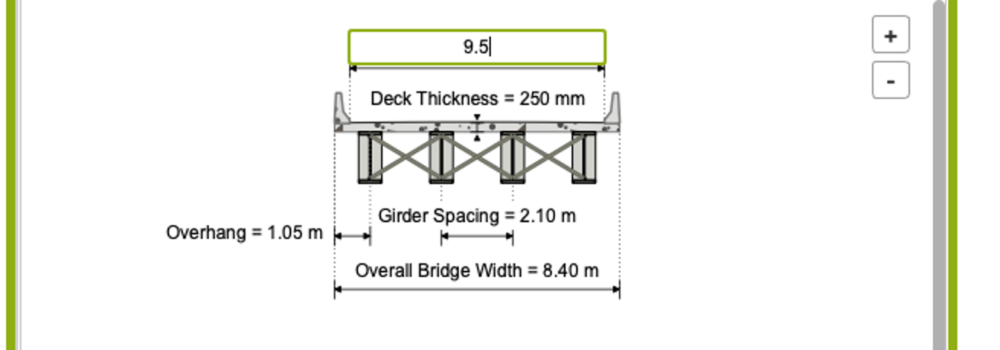
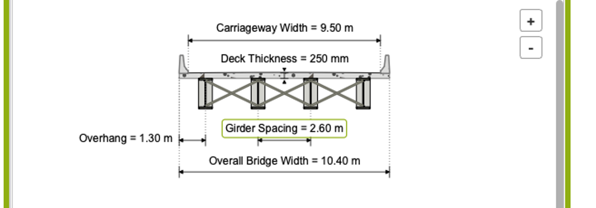
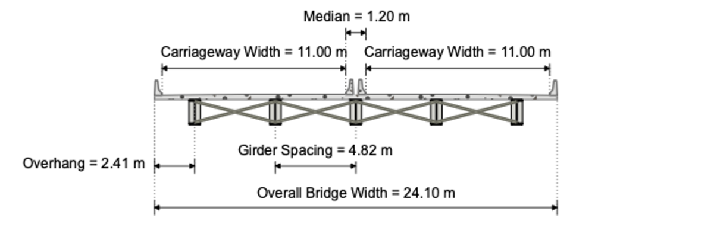
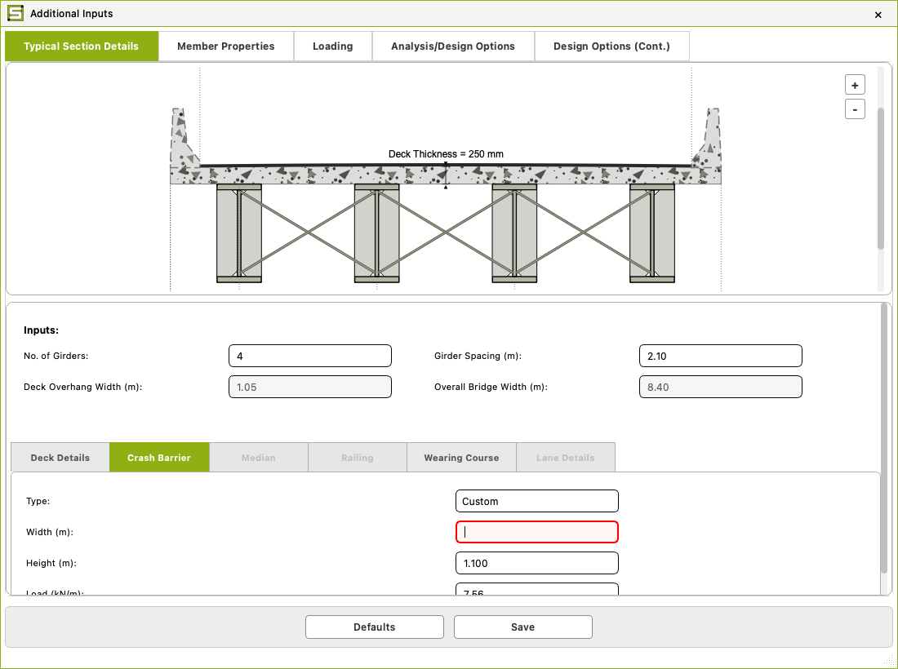
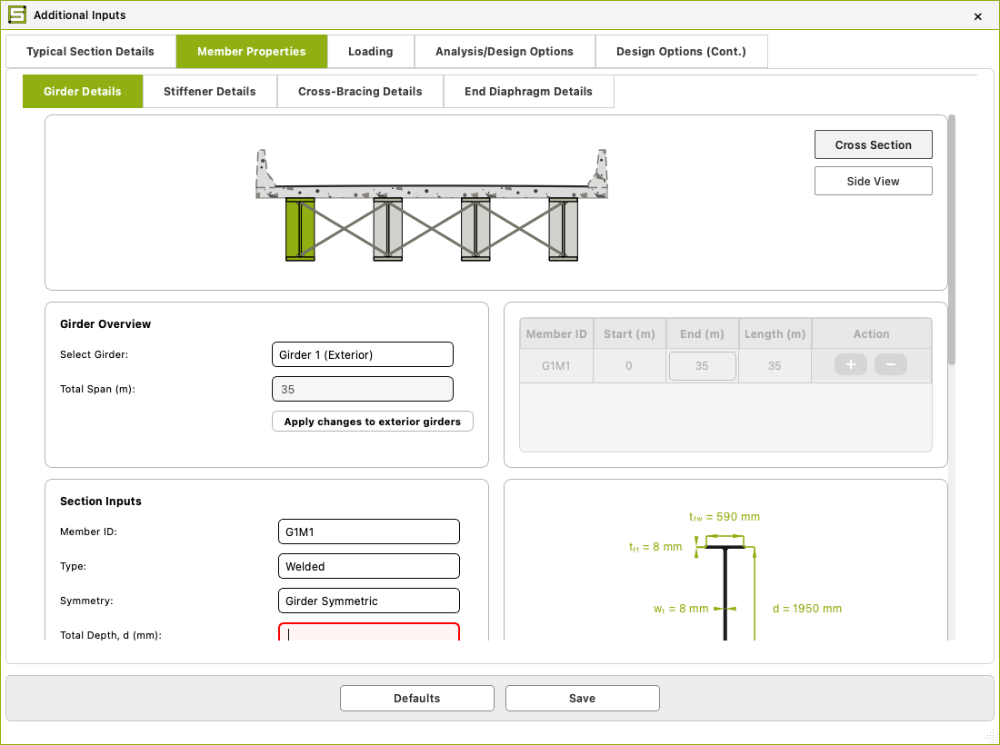
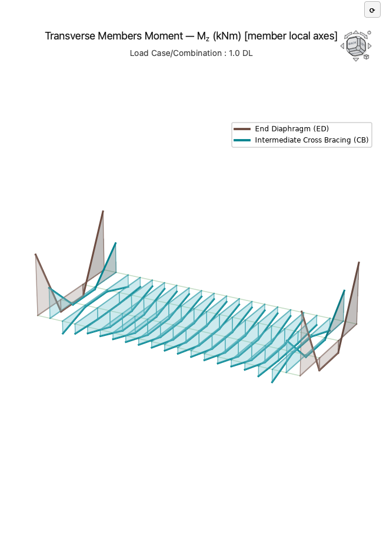
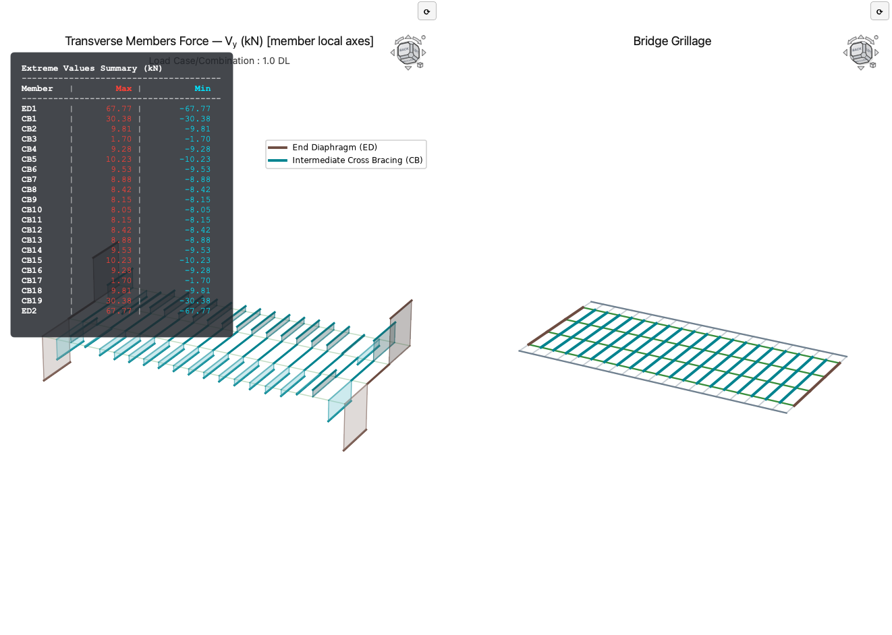
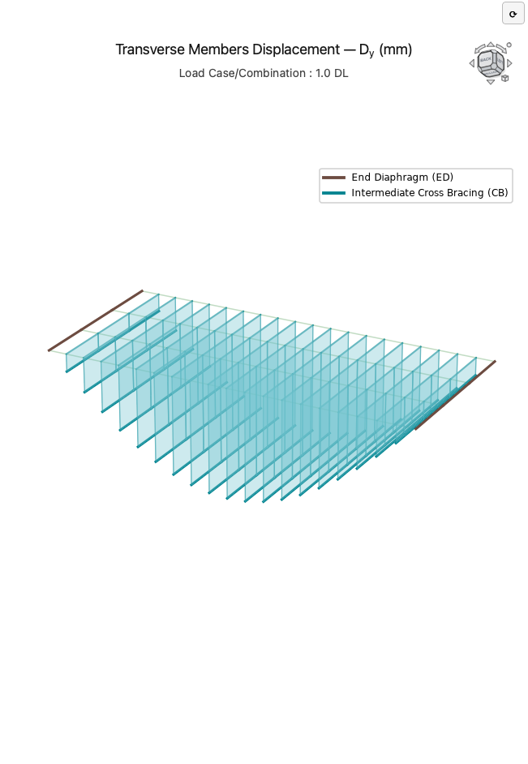

# OsdagBridge — UI, 2D CAD and Plotting Enhancements

Screening task report · branch based on `dev` @ `d74f56d`

**Demo video:** https://youtu.be/x8MaiePFDUI  
**Code:** https://github.com/Aditya-Sarna/OsdagBridge/tree/screening-task-solution

| Task | What was built | Where |
|---|---|---|
| I | Double-click editing of CAD dimension labels, synced to the inputs | `docks/cad_label_editor.py`, `utils/cad_parameter_sync.py`, `cad_cross_section.py`, `cad_top_view.py`, `cad_dual_view.py`, `template_page.py`, `defaults.py` |
| II | Pre-save validation of empty *Custom* fields; unsaved-changes guard | `custom_value_rules.py`, `additional_inputs.py`, `ui_fields_additional_input.py`, `common.py`, `dialogs/tabs/common.py` |
| III | Result plots for transverse members (end diaphragms + intermediate cross-bracings) | `results_data.py`, `results_data_post_processing.py`, `plot_generator.py`, `mpl_plot_widget.py`, `output_dock.py`, `plategirderbridge.py` |
| — | Tests | `tests/unit/test_transverse_members.py`, `tests/unit/test_additional_inputs_rules.py`, `tests/gui/` (opt-in UI scenarios) |

No existing behaviour was removed. A full Design run produces **byte-identical design output**
(all 1043 scalar outputs and all 57 cross-bracing results) before and after these changes.

---

## Task I — Interactive 2D CAD parameter editing

### Approach

The CAD widgets paint every dimension label through `draw_text_with_background()`. Instead of
re-computing label positions for hit-testing (fragile, and different for each zoom level / median /
footpath configuration), the label rectangle is **recorded at paint time**:

```python
# key from common.py; draw_text_with_background() registers the label rect
with self.cad_label(KEY_TS_GIRDER_SPACING):
    self.draw_dimension_arrow(..., label_gs, ...)
```

A shared mixin, `EditableCADLabelsMixin` (`docks/cad_label_editor.py`), is used by both the
cross-section and the top-view widget. It provides:

* the per-frame label registry (`QRectF` + `common.py` key), rebuilt on every `paintEvent`;
* `mouseDoubleClickEvent` → hit-test → an in-place `QLineEdit` placed over the label, pre-filled
  with the current value (numeric-only validator), **Enter or clicking elsewhere commits, Esc cancels**;
* hover affordances: a green outline + pointing-hand cursor + "Double-click to edit …" tooltip on
  editable labels, a dashed grey outline + forbidden cursor on locked labels;
* a Qt signal `parameter_edit_requested(key, value)` — the widget never touches input data itself.

`BridgeDualCADWidget` forwards the signal from both views. Editing is **opt-in** (enabled only for the
main template CAD) so the Additional Inputs preview, which reuses `CrossSectionCADWidget`, and the
report renderer are unaffected.

`CADParameterSync` (`desktop/ui/utils/cad_parameter_sync.py`) is the single place that validates and
applies an edit:

| Parameter | Key | Validation | Applied to |
|---|---|---|---|
| Carriageway Width | `KEY_CARRIAGEWAY_WIDTH` | `BridgeInputValidator.validate_basic_inputs` (IRC 5 Cl. 104.3.1 + software limit) | Basic Inputs field → `InputDock._on_field_edited` (same path as typing) |
| Span Length | `KEY_SPAN` | `validate_basic_inputs` (20–45 m) | Basic Inputs field → same path |
| Girder Spacing | `KEY_TS_GIRDER_SPACING` | `validate_additional_inputs` + layout solver | `resolve_girder_spacing()` — girder count fixed, overhang re-derived from `(n−1)·s + 2·o = W` |
| Deck Thickness | `KEY_TS_DECK_THICKNESS` | `validate_additional_inputs` (100–500 mm) | input dictionary |

After applying, the CAD is redrawn from the input dictionary (`update_from_osdag_inputs`), so the
drawing always reflects what was stored. Invalid values are **rejected, the previous value is kept**,
and the reason is shown with the standard `CustomMessageBox` and written to the log.

`resolve_girder_spacing()` was added to `defaults.py` next to `solve_extend_basic_input_dict()`; the
solver construction both use was extracted into `_build_layout_solver()` instead of being duplicated.
It uses `changed_field="spacing"` — the same rule the Additional Inputs dialog applies — and leaves
the dictionary untouched on failure.

**Locked parameters.** Overhang (`KEY_TS_DECK_OVERHANG`), Overall Bridge Width (`KEY_TS_OVERALL_WIDTH`)
and Bracing Spacing (`KEY_MP_CB_SPACING`) are registered as labels too, but are never opened for
editing; double-clicking shows a tooltip explaining what they are derived from and what to edit
instead.

**State consistency.** The app re-defaults all additional inputs whenever a *required* basic input
(Span, Carriageway Width) changes. Without care, a Girder Spacing or Deck Thickness typed on the
drawing would silently revert the next time Span changed. The controller therefore

* settles any pending re-default *before* applying a Girder Spacing / Deck Thickness edit, and
* keeps user-set values of the two CAD-editable additional inputs. Every layout solve in the page
  goes through one helper (`template_page._solve_layout` → `CADParameterSync.solve_layout`). It
  records what the solver wrote for Girder Spacing and Deck Thickness; at the next solve, a value that
  differs from that record was set by the user, on the CAD *or* in the Additional Inputs dialog, and is
  re-applied after the re-default. Deck Thickness is re-applied as is. Girder Spacing is re-solved
  against the new width with the same girder count (overhang re-derived). If the old spacing no longer
  fits, the default is kept and the log says so. Values nobody touched keep following the solver, and
  loading an OSI file starts afresh.

Girder Spacing / Deck Thickness edits are refused (with a clear message) until Span and Carriageway
Width exist, because the layout cannot be solved without them. Editing is blocked while the input
dock is locked or an analysis is running.

### Drawing fixes required for reliable hit-testing

Overlapping labels make double-click targets ambiguous, so three overlaps in the original drawing
were fixed (visible once values are shown):

* Carriageway Width text now sits *above* its dimension line (it overlapped Deck Thickness).
* Overhang text is placed outside the dimension, left of the deck edge, when it does not fit inside
  (it ran into the Girder Spacing label).
* With a median, the Median dimension moved one row up with its text above the line.


*Carriageway Width being edited in place.*


*After edits: values shown, Overhang placed outside, hover outline on Girder Spacing.*


*Median configuration at the smallest zoom — all labels separate.*

---

## Task II — Additional Inputs: validation and state management

### Which fields are "Custom"? — derived from the schema, no hard-coded strings

`core/bridge_types/plate_girder/custom_value_rules.py` walks `ADDITIONAL_INPUTS_SCHEMA` once and
produces `CustomValueRule(selector_key, selector_source, value_key, label_key)` records. Three
patterns exist in the schema:

1. `TYPE_MODE_LINE` fields with `VALUE_CUSTOM` in `mode_choices` → `<id>.mode` unlocks `<id>.value`
   (wind coefficients, seismic loads, footpath pressure, camber, …).
2. `TYPE_ADAPTIVE` fields whose `VALUE_CUSTOM` mode is a textbox → the design-mode controller
   (`KEY_DESIGN_MODE`) unlocks the girder depth / flange widths.
3. `TYPE_COMBOBOX` with a `VALUE_CUSTOM` choice. Which inputs such a combo unlocks is not encoded
   anywhere, so a new schema attribute, `SCHEMA_ATTR_CUSTOM_FIELDS`, declares it with `KEY_*`
   constants (crash barrier, median, railing type, railing load mode, wearing-course material).

New constants in `common.py`: `VALUE_CUSTOM`, `KEY_SUFFIX_MODE`, `KEY_SUFFIX_VALUE`,
`KEY_SUFFIX_LABEL`, `SCHEMA_ATTR_CUSTOM_FIELDS`. Parameter names in messages come from the field's
own label widget (`<key>_label`) plus its sub-tab title, so nothing is duplicated. 30 rules are found
in the current schema; new fields of these types are covered automatically.

### Pre-save validation

`_save_inputs()` first calls `validate_custom_fields()`, which visits every rule across all tabs.
A rule fails when its selector is `Custom` and the value field is empty. Fields the user cannot fill
are skipped: disabled (inactive tab, e.g. Median without a median), read-only, or hidden by the form
logic (e.g. crash-barrier density for a Custom barrier). On failure the save is halted and:

* the standard `CustomMessageBox` (Critical) lists every missing field as
  `Error: The custom value for '<Parameter Name>' cannot be empty.`
  e.g. `'Crash Barrier: Width (m)'`, `'Wind Load: Gust Factor, G'`, `'Girder Details: Total Depth, d (mm)'`;
* the dialog switches to the (sub-)tab of the first missing field and focuses it;
* every missing field gets a red error border, cleared as soon as the user types in it.





### Unsaved changes

`self.is_modified` is updated on every input change (`_update_input_dict`) by comparing
`working_input_dict` with a clean snapshot. A snapshot comparison is used rather than a plain
"set True on change" flag because opening the dialog programmatically re-computes widgets (e.g.
`refresh_typical_section()` toggles combo boxes), which would otherwise mark a freshly opened dialog
as modified; it also means changing a value and changing it back is correctly *not* modified. The
snapshot is taken when the dialog is shown (and again after queued refreshes) and after a
successful Save.

`closeEvent` (title-bar ✕) **and** `reject` (Esc key, which bypasses `closeEvent` in Qt) both go
through `_confirm_discard_changes()`:

* the field currently being typed in is committed first (the ✕ tool button does not take focus);
* the stiffener member on screen is flushed (same as Save does);
* if modified: Warning dialog *"You have unsaved changes. Closing this window will discard them. Do
  you want to proceed?"* with **Discard / Cancel**. Cancel keeps the dialog open; Discard restores the
  committed values and closes.

---

## Task III — Result plotting for transverse members

### Model background

In the ospgrillage model built by `analyser.create_model()`:

* `start_edge` / `end_edge` groups → transverse members on the support lines = **end diaphragms**;
* `transverse_slab` group → the interior transverse members = **intermediate cross-bracings**
  (the same members `crossbracingforces.py` designs);
* transverse members touching an **edge beam** are deck-overhang strips, not diaphragms/bracings.

Previously `results_data._build_full_data` labelled every non-longitudinal element "transverse",
so overhang strips were mixed in with bracings.

### Data mapping and extraction (`results_data.py`)

* `classify_grillage_members(nodes, members, edge_dist, groups)` splits every element tag into
  `longitudinal`, `end_diaphragms`, `cross_bracings`, `deck_transverse`. A transverse element counts
  as structural only if its two nodes lie on two **different main girders**. With ospgrillage groups
  the end/intermediate split uses `start_edge`/`end_edge`; without them (e.g. a JSON dump) the support
  lines are recognised geometrically. On the analysed model both methods give identical sets, and the
  four sets form a complete, disjoint partition of all 225 elements (120 / 6 / 57 / 42).
* `build_transverse_lines()` groups those elements into lines across the deck (connected components,
  so skewed oblique meshes work), ordered along the span and named `ED1`, `CB1…CBn`, `ED2`.
* `extract_transverse_results(ds, key, …, loadcase=)` returns, for the selected load case, each
  line's segments with end values for `Fx, Vy, Vz, Tx, My, Mz` (kN / kNm) or nodal `Dx, Dy, Dz` (mm),
  plus line max/min. Sign conventions match the existing girder plots (forces `(f_start, −f_end)`,
  displacements positive = sag).
* `_build_full_data` now stores `transverse_members` (= end diaphragms + cross-bracings) and the
  separate lists; `get_transverse_member_groups(model)` reads the groups and the backend exposes it
  as `get_member_groups()`.

**Member local axes.** ospgrillage reports element end forces in *global* axes. That is fine for
girders (they run along global X), but for a member across the width the moment about global X is
its bending moment and the moment about global Z its torsion. Plotting the raw components under the
girder labels would show bending as "torsion". `extract_transverse_results` therefore rotates each
member's end forces into its own frame (`member_local_axes`: x along the member, y vertical,
z = x × y, the OpenSees convention; for a girder this is the identity). The nine components keep
exactly the meaning they have on the girder plots: `Fx` axial, `Vy`/`Vz` shear, `Tx` torsion,
`My`/`Mz` bending. Every segment is oriented across the width (increasing Z), so a line's diagram is
continuous whichever way its elements were defined.

Checks on the analysed model, load case 1.0 DL: cross-bracing bending appears in `Mz` and is
continuous across every girder joint (jump 0.000 kNm); `Tx` is ≤ 0.002 kNm; `Fx` and `Vz` are zero,
as expected for vertical load. Unit tests cover the rotation, a reversed-element case and a skewed
member.

### Plot and UI

* The Output dock's analysis **Member** dropdown gets one extra entry, **Transverse Members**
  (`VALUE_ANALYSIS_MEMBER_TRANSVERSE`).
* `plot_generator.build_figure_transverse()` draws every line as a filled diagram across the deck
  width, with end diaphragms and cross-bracings in different colours and a legend. It reuses the
  existing Max / Min / All-values / Summary toggles, hover read-outs (line, element, node, value), the
  engineering scale, supports and the coordinate triad. The summary HUD lists one row per line.
* `MplPlotWidget` routes the selection; it keeps the user's camera only between plots of the same
  family, because a girder elevation view would show transverse diagrams edge-on.
* The Grillage view with *Transverse Members* selected highlights those members on the full mesh.


*Bending (`Mz`, member axes) of the end diaphragms and cross-bracings under dead load.*




*Mid-span cross-bracing deflection (−31.99 mm) equals the girder mid-span deflection in the existing
girder plot, a check that extraction and sign convention match.*

---

## Testing

**GUI scenario tests** (`tests/gui/`, 34 tests, opt-in). They drive the real `CustomWindow`
off-screen with real double-clicks and key presses (`QTest`); message boxes are captured instead of
blocking, and the OpenGL viewer is stubbed. Run them with:

```
OSDAG_GUI_TESTS=1 QT_QPA_PLATFORM=offscreen pytest tests/gui
```

* Task I (18): edits of all four parameters in both views, with the dictionary, dock field and CAD
  checked after each; invalid deck thickness / spacing / span rejected and the old value kept; Esc
  cancels; focus-out commits; locked labels and a locked dock never open an editor; CAD edits
  survive a Span change and are re-solved after a Carriageway change; no two clickable labels
  overlap at the fitted size or zoomed out to half, and where labels do touch (far zoomed out)
  the one drawn on top is the one edited.
* Task II (13): clean save; three empty Custom fields block Save with the exact message, commit
  nothing and highlight the field; filling them saves and clears the flag; change-then-revert is
  not a modification; ✕ / Esc with Cancel keep the dialog; Discard drops the edits; typing without
  Enter followed directly by ✕ still warns; Custom design mode with an empty girder depth; spacing and
  thickness saved in the dialog survive repeated Span changes; opening the dialog without edits
  leaves the defaults following the solver. The three value-keeping tests fail if it is switched off.
* Task III (3): a full Design run, *Transverse Members* is the last dropdown entry, and all nine
  components plot ED1…CBn…ED2. Dead load gives `Mz` bending with `Tx` under 1 % of it. Changing
  the load case changes the results; G2 returns to the girder plot. Every plot toggle (summary,
  max, min, all values, nodes, axes, supports, grid, labels, node / element numbers, grillage) works
  on the transverse plot, and the max / min / all-value markers really show and hide.

The GUI tests are skipped by default (they need a display-capable PySide6 / pythonOCC install and
take about 3 minutes in total), so `pytest` on a headless CI runner is unaffected.

* **Unit tests** (`pytest tests/unit`): synthetic-grillage tests for classification, naming,
  local-axis rotation, element-orientation independence, force/displacement extraction and sign
  conventions; schema-rule discovery; the girder-spacing helper. 23 passed.
* **Regression:** the same Design run on unmodified upstream code and on this branch produces
  identical results (all 1043 design outputs and all 57 cross-bracing results).
* **Platforms:** developed on macOS, where every test passes. Also run on **Linux x86_64**
  (Debian, glibc 2.41, PySide6 6.11.3) in a container, with a virtual display (Xvfb, which
  OpenCascade needs on Linux):
  * all 23 unit tests pass;
  * the same Design on upstream `dev` and on this branch gives identical output (1043 values,
    57 cross-bracings);
  * the Additional Inputs and transverse-plot UI tests pass;
  * the 2D CAD label tests do not yet pass there. Linux fonts are wider and the start-up layout
    leaves the drawing about half the size it is on macOS. Below 5 px of deck thickness the
    original drawing code skips the Deck Thickness label, so there is nothing to double-click,
    and two top-view labels touch at half zoom. On a real screen the user zooms in; making the
    tests independent of this is the remaining follow-up.

  This testing found and fixed two real bugs: an empty 4 px click target next to the Overhang
  label, and the Overhang text overlapping Girder Spacing on a small drawing. Windows was not run.

## Notes and limitations

* Only Girder Spacing and Deck Thickness (the additional inputs that can be edited on the CAD) are
  kept across a Span / Carriageway change. The other additional inputs are re-defaulted as before;
  changing that rule for every field would change the app's existing behaviour beyond this task.
* The model places interior transverse grid lines at half the cross-bracing spacing
  (`n_t` in `plategirderbridge._build_dtos`); all of them are reported as cross-bracings, consistent
  with `crossbracingforces.py`.
* Existing validator issue found while testing, not changed: a *Custom* wearing-course density is
  capped at 10 kN/m³ (`validator.py`, `KEY_WC_DENSITY`), below concrete (~24) and bituminous (~22).

## Demo video checklist

1. Basic Inputs: Span 30, Carriageway 7.5 → values appear on the CAD.
2. Hover labels (green outline vs locked dashed outline); double-click Overhang → read-only tooltip.
3. Double-click Carriageway Width → 9.5 ↵; Girder Spacing → 2.2 ↵ (overhang re-derived); Deck
   Thickness → 300 ↵; Span in top view → 40 ↵; try 50 mm deck thickness → rejected.
4. Additional Inputs: Crash Barrier → Custom, clear Width; Wind → Gust Factor Custom, leave empty;
   Save → error naming both, tab jumps, red field. Fill, Save.
5. Change a value, ✕ → Cancel; ✕ → Discard; reopen to show the value reverted.
6. Change Span to 35 → the CAD-edited girder spacing and deck thickness stay.
7. Design → Plots → Member: *Transverse Members*; cycle Vy, Mz (bending), Tx (≈ 0), Dy; toggle Summary and Max/Min;
   change load case; select G2 to show girder plots are unchanged.
